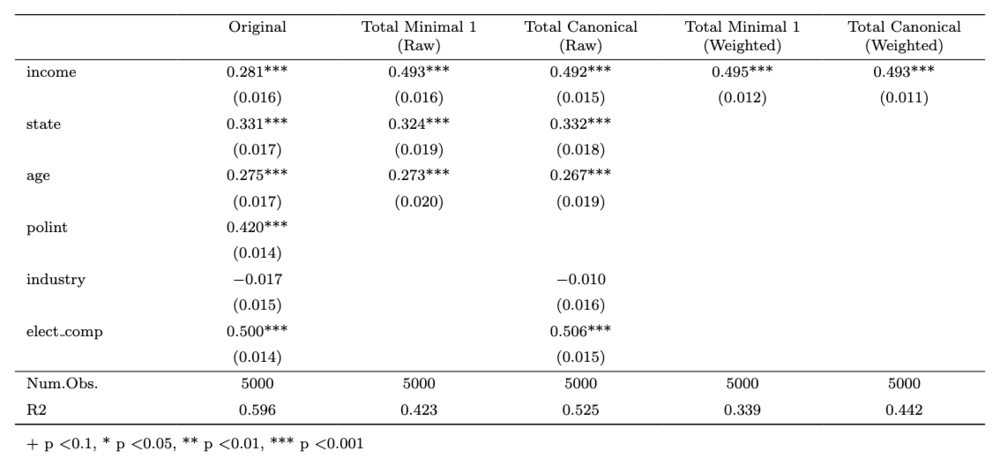
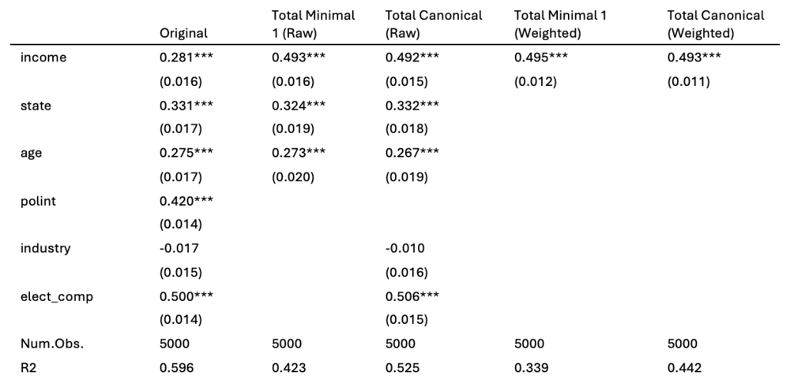
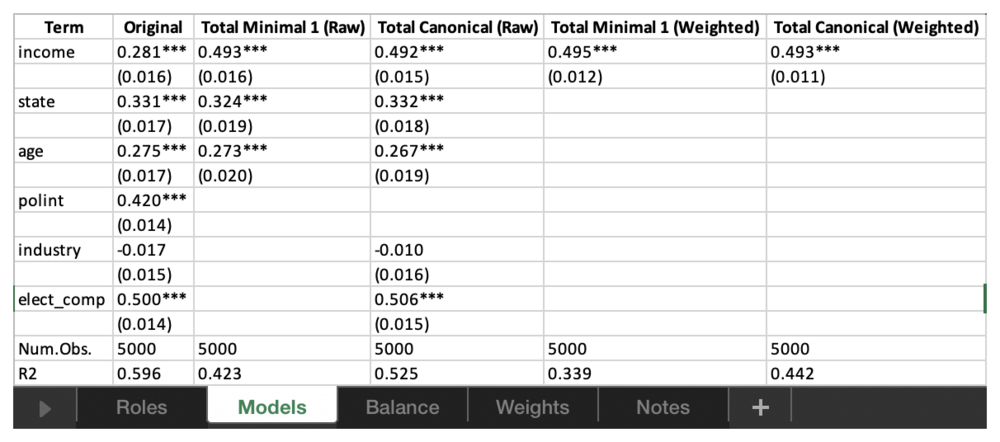
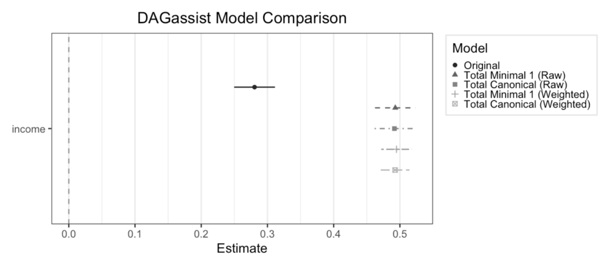

<!-- README.md is generated from README.Rmd. Please edit that file -->
```{r setup, include=FALSE}
knitr::opts_chunk$set(
  collapse = TRUE, 
  comment = "#>",
  fig.path = "man/figures/README-", out.width = "100%",
  dpi = 150
)

devtools::load_all(quiet = TRUE)
library(ggplot2)
library(dotwhisker)
```

```{r col, include=FALSE}
# make knitr treat output as plain text to pass r-comd-check
options(
  DAGassist.color = FALSE,  # we'll wire this up below
  crayon.enabled = FALSE
)
Sys.setenv(NO_COLOR = "1")
```

# DAGassist: Align Regressions with Target Estimands <a href='https://grahamgoff.com/DAGassist/'></a>
<!-- badges: start -->
[](https://github.com/grahamgoff/DAGassist/actions/workflows/R-CMD-check.yaml)
[](https://cran.r-project.org/package=DAGassist)
[](https://lifecycle.r-lib.org/articles/stages.html)
[](https://cran.r-project.org/package=DAGassist)
<!-- badges: end -->

Adding a control variable can change what a regression estimates, not just how precisely it estimates it. Controlling for mediators can shift the estimand, while controlling for colliders or their descendants can introduce bias. **DAGassist** uses your causal diagram (DAG) and existing regression to classify variables by their causal role, flag potentially inappropriate controls, and automatically reestimate the model using DAG-derived adjustment sets. It can also estimate explicitly specified causal effects and generate publication-grade diagnostic reports. 

---

## Installation 

You can install `DAGassist` with:
```{r cran, eval=FALSE}
install.packages("DAGassist")
```

You can also install the development version using `devtools`:

```{r install, eval = FALSE}
# install.packages("devtools")
devtools::install_github("grahamgoff/DAGassist")
```

## Example

Does higher income increase voter turnout? `DAGassist` includes a simulated dataset, `turnout_data`, and its corresponding causal diagram, `turnout-dag`. Because the data-generating process is known, we know that income's **total** effect is 0.50, of which 0.30 is **direct** and 0.20 operates through political interest. 

```{r load-data, eval=FALSE}
#load example data
data("turnout_data")
data("turnout_dag")
```

```{r ex-dag, echo=FALSE, message=FALSE, warning=FALSE, fig.height=3.5, fig.width=7}
library(dagitty)
library(ggdag)

x_pos <- c(
  turnout = 10,
  income = 0,
  parental_ses = 5,
  age  = 5,
  polint = 5,
  industry = 0,
  elect_comp = 10
)

y_pos <- c(
  turnout = 0,
  income = 0,
  parental_ses = 1,
  age  = -1,
  polint = 0.5,
  industry = -0.75,
  elect_comp = -0.75
)


dag_model <- dagify(
  
  turnout ~ income + parental_ses + age + polint + elect_comp,
  
  income ~ parental_ses + age + industry,
  
  polint ~ income,
  
  industry ~ age,
  
  exposure = "income",
  outcome  = "turnout",
  
  coords = list(x= x_pos, y = y_pos),

  labels = c(
    turnout = "Turnout",
    income = "Income",
    parental_ses = "Parental SES",
    age  = "Age",
    polint = "Political Interest",
    industry = "Industry",
    elect_comp = "Election Competitiveness"
  )
)

#coordinates for dag labels
label_df <- data.frame(
  name = c("turnout", "income", "parental_ses", "age", "polint", "industry", "elect_comp"),
  label_x = c(10, 0, 5, 5, 5, 0, 9),
  label_y = c(0, 0, 1, -1, 0.55, -0.75, -0.75)
)

# pull labels safely from dagitty object
labels_vec <- attr(dag_model, "labels")

label_df$label <- unname(labels_vec[label_df$name])

# ---- plot: ggdag without labels, then add manual labels
p <- ggdag_status(dag_model, text = FALSE) +
  theme_dag() +
  scale_fill_manual(values = c(exposure="black", outcome="grey30", none="grey90")) +
  scale_color_manual(values = c(exposure="black", outcome="grey30", none="grey60")) +
  theme(legend.position = "none") +
  geom_label(
    data = label_df,
    aes(x = label_x, y = label_y, label = label),
    inherit.aes = FALSE,   
    size = 3.4,
    label.size = 0.25
  )

p

```

A common approach is to control for every available predictor of the outcome. However, whether a control is appropriate depends on its causal role. `DAGassist` uses the DAG to identify these roles and automatically reestimates models using valid adjustment sets. To get started, simply provide your DAG and original regression call:

```{r roles, results='asis'}
DAGassist(turnout_dag,
          lm(turnout ~ income + parental_ses + age + polint + industry + elect_comp,
             data = turnout_data),
          show = "roles", type = "text", verbose = FALSE)
```
`DAGassist` identifies `polint` as a mediator (i.e., it is one of the mechanisms through which income affects turnout). Controlling for it therefore shifts the estimand away from the total effect. In this simulation, the resulting coefficient approximates the direct effect. The [causal roles guide](https://grahamgoff.com/DAGassist/articles/DAGassist.html) explains each classification in greater detail.

```{r compare, results='asis'}
DAGassist(turnout_dag,
          lm(turnout ~ income + parental_ses + age + polint + industry + elect_comp,
             data = turnout_data),
          show = "models", type = "text", verbose = FALSE)
```

The original regression estimates an effect of approximately 0.28, close to the true direct effect of 0.30. By excluding the mediator, both DAG-derived specifications produce estimates of approximately 0.49, close to the true total effect of 0.50. Without `DAGassist`, a researcher might mistakenly interpret the original coefficient as a total effect. `DAGassist` identifies the estimand-shifting control and automatically reestimates the model using appropriate adjustment sets.

```{r estimates, echo = FALSE, fig.width = 7, fig.height = 2.6, fig.alt = "Estimated effect of income on turnout with 95% confidence intervals. The original regression gives 0.28, close to the true direct effect of 0.30. The DAG-derived minimal and canonical specifications give 0.49, matching the true total effect of 0.50."}
report <- DAGassist(
  turnout_dag,
  lm(turnout ~ income + parental_ses + age + polint + industry + elect_comp,
     data = turnout_data)
)

specs <- c(
  "Original: all controls"                        = "original",
  "Minimal: {age, parental_ses}"                         = "minimal",
  "Canonical: {age, parental_ses, industry, elect_comp}" = "canonical"
)
est <- do.call(rbind, lapply(names(specs), function(lab) {
  m  <- report$models[[specs[[lab]]]]
  ci <- confint(m)["income", ]
  data.frame(spec = lab, est = coef(m)[["income"]], lo = ci[[1]], hi = ci[[2]])
}))
est$spec <- factor(est$spec, levels = rev(names(specs)))
est$original <- est$spec == names(specs)[1]

ggplot(est, aes(est, spec)) +
  geom_vline(xintercept = c(0.30, 0.50), linetype = "dashed",
             colour = "grey60", linewidth = 0.4) +
  annotate("text", x = c(0.30, 0.50), y = 3.55,
           label = c("true direct effect", "true total effect"),
           size = 3.3, colour = "grey35", vjust = 0) +
  geom_linerange(aes(xmin = lo, xmax = hi, colour = original), linewidth = 1) +
  geom_point(aes(colour = original), size = 2.8) +
  geom_text(aes(label = sprintf("%.2f", est)), nudge_y = 0.3,
            size = 3.4, colour = "grey20") +
  scale_colour_manual(values = c(`TRUE` = "#AC4848", `FALSE` = "#3D3535"),
                      guide = "none") +
  scale_x_continuous(limits = c(0.2, 0.6), breaks = seq(0.2, 0.6, 0.1)) +
  scale_y_discrete(expand = expansion(add = c(0.5, 0.9))) +
  labs(x = "Estimated effect of income on turnout (95% CI)", y = NULL) +
  theme_minimal(base_size = 12) +
  theme(panel.grid.minor = element_blank(),
        panel.grid.major.y = element_blank())
```

## What else DAGassist does

- **Target an estimand explicitly.** `estimand = "total"` estimates sample-average total effects using inverse-probability weighting; `"direct"` uses sequential g-estimation, including weighted direct-effect estimates.
- **Stress-test the DAG.** `pdag_robustness()` evaluates uncertain arrow directions; `add_edges_robustness()` checks potentially omitted causal relationships.
- **Check whether the data support the estimates.** Diagnostics assess sample-composition changes, effective sample sizes, and weighting problems.
- **Work with existing regression models.** DAGassist supports `lm`, `glm`, `fixest`, `lme4`, `estimatr`, and other common regression engines ([supported models](https://grahamgoff.com/DAGassist/articles/compatibility.html)).
- **Export publication-ready reports.** Set `type` to `"latex"`, `"word"`, `"excel"`, `"text"`, or `"dotwhisker"` to generate formatted reports and figures.


<table class="gallery"><tr>
<td><a href="https://raw.githubusercontent.com/grahamgoff/DAGassist/main/man/figures/README-latex.png"></a><br><em>LaTeX (<code>tabularray</code>)</em></td>
<td><a href="https://raw.githubusercontent.com/grahamgoff/DAGassist/main/man/figures/README-word.png"></a><br><em>Word</em></td>
</tr><tr>
<td><a href="https://raw.githubusercontent.com/grahamgoff/DAGassist/main/man/figures/README-excel.png"></a><br><em>Excel</em></td>
<td><br><em>dotwhisker</em></td>
</tr></table>


## Citation

```{r}
citation("DAGassist")
```

