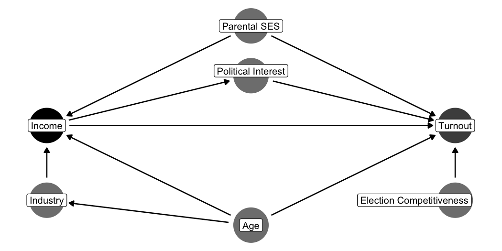
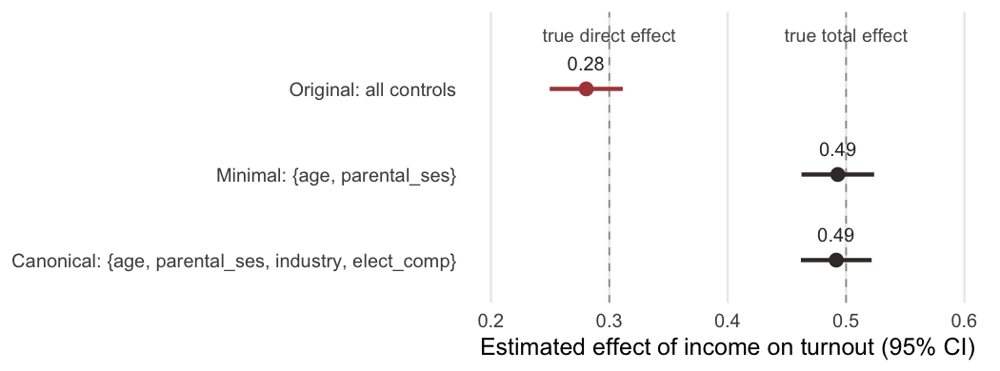
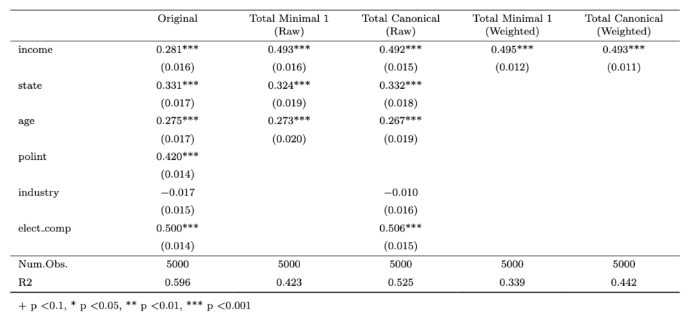
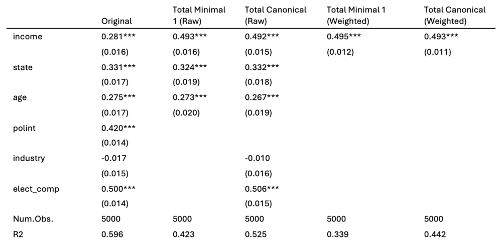
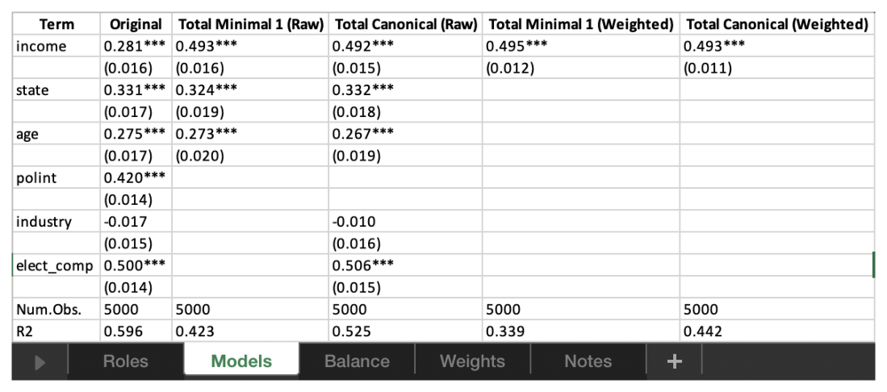
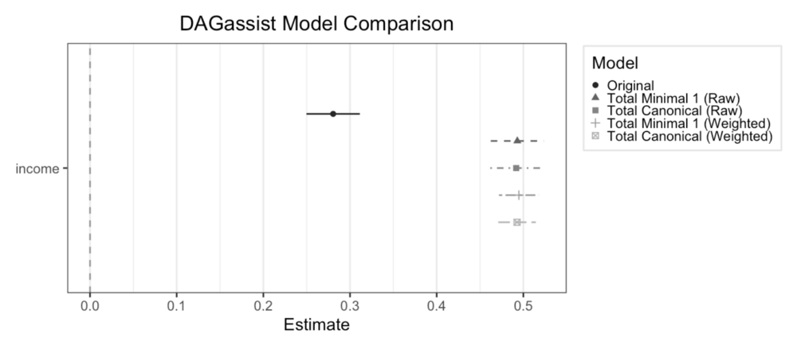

<!-- README.md is generated from README.Rmd. Please edit that file -->

# DAGassist: Align Regressions with Target Estimands <a href='https://grahamgoff.com/DAGassist/'></a>

<!-- badges: start -->

[](https://github.com/grahamgoff/DAGassist/actions/workflows/R-CMD-check.yaml)
[](https://cran.r-project.org/package=DAGassist)
[](https://lifecycle.r-lib.org/articles/stages.html)
[](https://cran.r-project.org/package=DAGassist)
<!-- badges: end -->

Adding a control variable can change what a regression estimates, not
just how precisely it estimates it. Controlling for mediators can shift
the estimand, while controlling for colliders or their descendants can
introduce bias. **DAGassist** uses your causal diagram (DAG) and
existing regression to classify variables by their causal role, flag
potentially inappropriate controls, and automatically reestimate the
model using DAG-derived adjustment sets. It can also estimate explicitly
specified causal effects and generate publication-grade diagnostic
reports.

------------------------------------------------------------------------

## Installation

You can install `DAGassist` with:

``` r
install.packages("DAGassist")
```

You can also install the development version using `devtools`:

``` r
# install.packages("devtools")
devtools::install_github("grahamgoff/DAGassist")
```

## Example

Does higher income increase voter turnout? `DAGassist` includes a
simulated dataset, `turnout_data`, and its corresponding causal diagram,
`turnout-dag`. Because the data-generating process is known, we know
that income’s **total** effect is 0.50, of which 0.30 is **direct** and
0.20 operates through political interest.

``` r
#load example data
data("turnout_data")
data("turnout_dag")
```



A common approach is to control for every available predictor of the
outcome. However, whether a control is appropriate depends on its causal
role. `DAGassist` uses the DAG to identify these roles and automatically
reestimates models using valid adjustment sets. To get started, simply
provide your DAG and original regression call:

``` r
DAGassist(turnout_dag,
          lm(turnout ~ income + parental_ses + age + polint + industry + elect_comp,
             data = turnout_data),
          show = "roles", type = "text", verbose = FALSE)
```

| Variable     |    Role    | Exp. | Out. | `CON` | `MED` | dConfOn | `NCT` | `NCO` |
|:-------------|:----------:|:----:|:----:|:-----:|:-----:|:-------:|:-----:|:-----:|
| age          | confounder |      |      |   x   |       |         |       |       |
| elect_comp   |    nco     |      |      |       |       |         |       |   x   |
| income       |  exposure  |  x   |      |       |       |         |       |       |
| industry     |    nct     |      |      |       |       |    x    |   x   |       |
| parental_ses | confounder |      |      |   x   |       |         |       |       |
| polint       |  mediator  |      |      |       |   x   |         |       |       |
| turnout      |  outcome   |      |  x   |       |       |         |       |       |

`DAGassist` identifies `polint` as a mediator (i.e., it is one of the
mechanisms through which income affects turnout). Controlling for it
therefore shifts the estimand away from the total effect. In this
simulation, the resulting coefficient approximates the direct effect.
The [causal roles
guide](https://grahamgoff.com/DAGassist/articles/DAGassist.html)
explains each classification in greater detail.

``` r
DAGassist(turnout_dag,
          lm(turnout ~ income + parental_ses + age + polint + industry + elect_comp,
             data = turnout_data),
          show = "models", type = "text", verbose = FALSE)
```

| Term         |  Original   |  Minimal 1  |  Canonical  |
|:-------------|:-----------:|:-----------:|:-----------:|
| income       | 0.281\*\*\* | 0.493\*\*\* | 0.492\*\*\* |
|              |   (0.016)   |   (0.016)   |   (0.015)   |
| parental_ses | 0.331\*\*\* | 0.324\*\*\* | 0.332\*\*\* |
|              |   (0.017)   |   (0.019)   |   (0.018)   |
| age          | 0.275\*\*\* | 0.273\*\*\* | 0.267\*\*\* |
|              |   (0.017)   |   (0.020)   |   (0.019)   |
| polint       | 0.420\*\*\* |             |             |
|              |   (0.014)   |             |             |
| industry     |   -0.017    |             |   -0.010    |
|              |   (0.015)   |             |   (0.016)   |
| elect_comp   | 0.500\*\*\* |             | 0.506\*\*\* |
|              |   (0.014)   |             |   (0.015)   |
| Num.Obs.     |    5000     |    5000     |    5000     |
| R2           |    0.596    |    0.423    |    0.525    |

- p-value legend: + \< 0.1, \* \< 0.05, \*\* \< 0.01, \*\*\* \< 0.001.
- Controls (minimal): {age, parental_ses}.
- Controls (canonical): {age, elect_comp, industry, parental_ses}.

The original regression estimates an effect of approximately 0.28, close
to the true direct effect of 0.30. By excluding the mediator, both
DAG-derived specifications produce estimates of approximately 0.49,
close to the true total effect of 0.50. Without `DAGassist`, a
researcher might mistakenly interpret the original coefficient as a
total effect. `DAGassist` identifies the estimand-shifting control and
automatically reestimates the model using appropriate adjustment sets.



## What else DAGassist does

- **Target an estimand explicitly.** `estimand = "total"` estimates
  sample-average total effects using inverse-probability weighting;
  `"direct"` uses sequential g-estimation, including weighted
  direct-effect estimates.
- **Stress-test the DAG.** `pdag_robustness()` evaluates uncertain arrow
  directions; `add_edges_robustness()` checks potentially omitted causal
  relationships.
- **Check whether the data support the estimates.** Diagnostics assess
  sample-composition changes, effective sample sizes, and weighting
  problems.
- **Work with existing regression models.** DAGassist supports `lm`,
  `glm`, `fixest`, `lme4`, `estimatr`, and other common regression
  engines ([supported
  models](https://grahamgoff.com/DAGassist/articles/compatibility.html)).
- **Export publication-ready reports.** Set `type` to `"latex"`,
  `"word"`, `"excel"`, `"text"`, or `"dotwhisker"` to generate formatted
  reports and figures.

<table class="gallery">

<tr>

<td>

<a href="https://raw.githubusercontent.com/grahamgoff/DAGassist/main/man/figures/README-latex.png"></a><br><em>LaTeX
(<code>tabularray</code>)</em>
</td>

<td>

<a href="https://raw.githubusercontent.com/grahamgoff/DAGassist/main/man/figures/README-word.png"></a><br><em>Word</em>
</td>

</tr>

<tr>

<td>

<a href="https://raw.githubusercontent.com/grahamgoff/DAGassist/main/man/figures/README-excel.png"></a><br><em>Excel</em>
</td>

<td>

<br><em>dotwhisker</em>
</td>

</tr>

</table>

## Citation

``` r
citation("DAGassist")
#> To cite package 'DAGassist' in publications use:
#> 
#>   Goff G, Denly M (2026). _DAGassist: Align Regressions with Target
#>   Estimands_. R package version 0.3.1,
#>   <https://grahamgoff.com/DAGassist/>.
#> 
#> A BibTeX entry for LaTeX users is
#> 
#>   @Manual{,
#>     title = {{DAGassist}: Align Regressions with Target Estimands},
#>     author = {Graham Goff and Michael Denly},
#>     year = {2026},
#>     note = {R package version 0.3.1},
#>     url = {https://grahamgoff.com/DAGassist/},
#>   }
```
